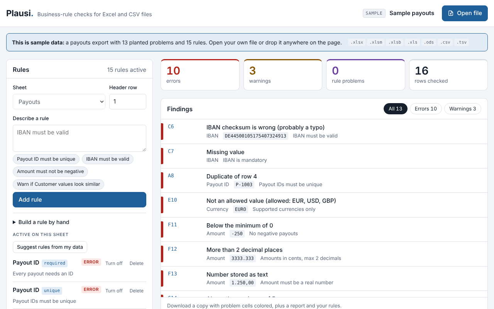

# Plausi: business-rule data checks for spreadsheets

**[Try it live](https://darkknight914914.github.io/plausi/)**: opens with sample data, or drop in your own Excel or CSV file. Files are read in your browser and never uploaded.



Most spreadsheet tools check whether a file is *broken*: formula errors, empty cells. Plausi checks whether the data *makes business sense*. It flags invalid IBANs, duplicate IDs, the same customer under two spellings, out-of-range rates, end dates before start dates, numbers stored as text, stale exports and totals that don't reconcile.

Open a file and Plausi suggests rules from your columns, so you see findings straight away. You can add your own rules in plain English or German ("Amount must not be negative", "Currency darf nicht leer sein").

*Plausi* comes from the German *Plausibilitätsprüfung*, a plausibility check.

## Three ways to use it

| | Works with | Install |
|---|---|---|
| **Plausi Checker** ([live](https://darkknight914914.github.io/plausi/), or `index.html` offline) | Any Excel or CSV file: .xlsx, .xlsm, .xlsb, .xls (Excel 97–2003), .ods, .csv/.tsv. Comma or semicolon CSVs, German number formats. | None. Open the file in a browser and drop a spreadsheet on it. Files are read in the browser and never uploaded. |
| **Browser extension** (`extension/`) | Everything the Checker does, plus right-click → check the tables on any web page, or check a linked Excel/CSV file without downloading it | Load unpacked in Chrome/Edge, see `extension/README.md` |
| **Google Sheets add-on** (the `.gs` files) | Native Google Sheets, with scheduled checks and Slack/Jira/e-mail alerts | See below |

Plausi works on any report or table, whatever the subject. It finds the header under title rows, names blank or repeated columns ("Column C", "Revenue (2)"), and leaves Total, Subtotal and footnote rows out of the data checks. When there is one Total row, it checks that each column adds up to it.

When you open a file that has no rules yet, the Checker suggests starter rules from the data: values that break the column's usual format (e.g. SO-20O2 among SO-2001…), unusually large or small numbers, stray spaces, percentages out of range, required columns, unique IDs, valid IBAN/BIC/e-mail, no negative amounts, cents-only decimals, usual codes (currency, country, status), usual values (e.g. terms of 12/24/36 months), same names spelled differently, and end dates that come before start dates. Review them, delete what doesn't fit, add your own.

Both use the same rule engine (`Engine.gs`) and the same "Plausi Rules" sheet format. Rules you set up in the Checker are saved into the downloaded workbook, so reopening that file restores them, and a Google Sheet built from it can use them too.

The Checker's **Marked-up workbook (.xlsx)** download contains your data with problem cells colored red or yellow, a "Plausi Report" sheet that links to each cell, and your rules. It opens in Excel, LibreOffice, Numbers and Google Sheets. It holds values only; formulas and original formatting are not copied.

Developers can rebuild the Checker with `python3 web/build.py` and the extension with `python3 extension-src/build.py` after editing `web/app.js`, `web/core.js`, `web/template.html` or the engine.

## Install the Google Sheets add-on (about 5 minutes)

1. Open any Google Sheet, then go to **Extensions → Apps Script**.
2. In the editor, create these files and paste in the contents:
   | File in this folder | Create in Apps Script as |
   |---|---|
   | `Engine.gs`, `Demo.gs`, `Code.gs`, `Alerts.gs`, `AI.gs` | Script files with the same names (drop `.gs`) |
   | `Sidebar.html` | HTML file named `Sidebar` |
   | `appsscript.json` | Click ⚙ **Project Settings**, tick **Show "appsscript.json"**, then replace its content |
3. Save, reload the spreadsheet, and use the new **Plausi** menu. Google will ask for permissions the first time.

If you prefer the command line, run `npm i -g @google/clasp`, then `clasp login`, `clasp create --type sheets --title Plausi` and `clasp push` from this folder.

## Try it

Choose **Plausi → Load demo data**, then **Run checks**. The demo is a fake payouts export with 13 planted problems: 10 errors and 3 warnings. Click any problem in the sidebar to jump to the cell. The full list, with links, is written to the **Plausi Report** sheet.

## Rules

Rules live in the **Plausi Rules** sheet, one per row: `Enabled | Sheet | Column | Check | Parameter | Severity | Description`. You can edit them directly or add them from the sidebar by describing them in words.

| Check | Parameter | Catches |
|---|---|---|
| `required` | – | empty cells |
| `number` | – | non-numbers, numbers stored as text (`1.250,00`) |
| `range` | `0..5`, `0..`, `..1000` | values out of range |
| `decimals` | `2` | too many decimals (e.g. amounts in fractions of a cent) |
| `date` / `not_future` | – | invalid dates (`31.02.2026`), future timestamps |
| `compare` | `>= Start date` | cross-column logic within a row |
| `allowed` | `EUR, USD, GBP` | values outside a list |
| `regex` / `length` | pattern / `22` or `8..11` | format problems |
| `email`, `iban`, `bic` | – | invalid contacts, IBAN typos (country length and checksum) |
| `unique` | optional extra columns | duplicate IDs or duplicate combinations |
| `fuzzy_duplicate` | – | "Müller & Söhne GmbH" vs "Mueller und Soehne" |
| `sum_equals` | `12500` or `Bank!B2` | column total that doesn't reconcile |
| `freshness` | `7` (days) | an export that stopped updating |
| `min_rows` | `10` | a suspiciously short export |
| `outlier` | `3` (sensitivity) | numbers far outside the column's usual range |
| `no_extra_spaces` | – | leading, trailing or double spaces that break lookups |

**Plain-language rules.** Without an API key, a built-in parser handles common phrasings, such as "IBAN must be valid", "End date must be on or after Start date" or "Currency darf nicht leer sein". With an Anthropic API key (Alerts tab), Claude handles anything expressible with the checks above, and can turn one sentence into several rules. Only the sentence and the column **names** are sent to Claude, never cell values.

## Alerts

In the **Alerts** tab, set a schedule (hourly, daily or weekly), then turn on e-mail and/or paste a Slack incoming webhook or a Jira Automation incoming-webhook URL. Only **new** errors trigger an alert, so a known problem doesn't ping you every hour. In Jira Automation, the payload fields are available as `{{webhookData.summary}}`, `{{webhookData.description}}` and `{{webhookData.issues}}`.

## Development

```
node tests/engine.test.js   # 51 tests: rule engine and plain-language parser
node tests/web.test.js      # 37 tests: CSV/Excel reading, starter-rule suggestions, the .xlsx writer
```

`Engine.gs` and `Demo.gs` are plain JavaScript with no Google services, so all the check logic is testable outside Sheets.

## Status

Prototype, tested on sample finance, sales and HR reports. Built with Claude as a coding partner.

## Ideas for v2

- Rule packs: ready-made rule sets for "payout file", "SEPA batch", "customer master data"
- Run history and trends ("IBAN errors per week")
- Check CSV files dropped into a Drive folder, not just sheets
- Publish to the Google Workspace Marketplace
